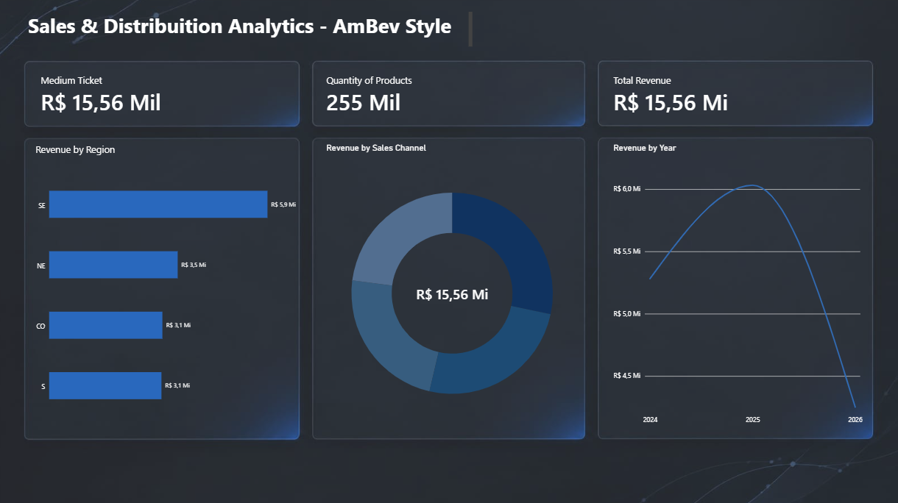

# 🍺 Sales & Distribution Analytics — AmBev Style


---

## 🎯 Sobre o Projeto
Este repositório apresenta uma solução completa de **Análise de Dados e Business Intelligence** inspirada nos processos de vendas, logística e distribuição do setor de bebidas (estilo AmBev). 

O projeto foi estruturado para demonstrar um **Pipeline de Dados End-to-End**, cobrindo desde a engenharia e síntese de dados programática até a entrega de valor para a tomada de decisão executiva.

---

## 🏗️ Arquitetura do Pipeline de Dados

```text
┌─────────────────────────┐         ┌──────────────────────────┐         ┌─────────────────────────┐
│     Script Python       │  ───►   │   Base de Dados (CSV)    │  ───►   │   Dashboard Power BI    │
│  (Geração & Simulação)  │         │   & Consultas SQL        │         │   (KPIs & Insights)     │
└─────────────────────────┘         └──────────────────────────┘         └─────────────────────────┘

🛠️ Stack Tecnológica
Python 3.13 (Pandas, NumPy): Automação da geração de massa de dados realista, aplicando regras de negócio, sazonalidade, preços unitários e volumetria.

SQL: Desenvolvimento de consultas analíticas avançadas (GROUP BY, agregações, subqueries e funções de janela) para extração de indicadores de desempenho.

Power BI Desktop: Modelagem de dados, tratamento visual e construção de um dashboard executivo focado em usabilidade e design limpo.

Git & GitHub: Versionamento de código e documentação técnica padronizada.

📊 Principais Indicadores e Métricas (KPIs)
O painel gerencial consolida as principais métricas operacionais e financeiras da operação:

Faturamento Total: R$ 15,56 Mi

Volume Total Comercializado: 255 Mil unidades

Ticket Médio por Pedido: R$ 15,56 Mil

Segmentação por Região: Análise de performance e penetração de mercado nas regiões Sul, Sudeste, Centro-Oeste e Nordeste.

Análise por Canal de Venda: Comparativo de eficiência entre Supermercados, Distribuidores, Bares/Restaurantes e Lojas de Conveniência.

📁 Estrutura do Repositório
ambev-sales-analytics/
│
├── gerar_dados.py              # Script em Python responsável pela criação do dataset
├── vendas_ambev_style.csv      # Base de dados estruturada (1.000 registros de vendas)
├── queries_analise.sql         # Consultas SQL analíticas para suporte à decisão
├── dashboard_vendas_ambev.pbix # Arquivo oficial do relatório interativo em Power BI
└── README.md                   # Documentação detalhada do projeto



🚀 Como Executar o Projeto
Se você quiser reproduzir ou testar o ambiente localmente:

1.Clonar o repositório:
git clone [https://github.com/matheuspaes777/ambev-sales-analytics.git](https://github.com/matheuspaes777/ambev-sales-analytics.git)

2.Gerar a base de dados via Python:
Certifique-se de ter o Python instalado com as bibliotecas pandas e numpy, e execute:
python gerar_dados.py

3.Explorar as Consultas Analíticas:
Abra o arquivo queries_analise.sql no seu gerenciador de banco de dados ou ferramenta de preferência compatível com SQLite/SQL.

4.Visualizar o Dashboard:
Abra o arquivo dashboard_vendas_ambev.pbix utilizando o Power BI Desktop para interagir com os filtros e indicadores visuais.

👤 Autor
Desenvolvido por Matheus Thiago Paes de Barros

Estudante de Bacharelado em Ciência da Computação — UNG
